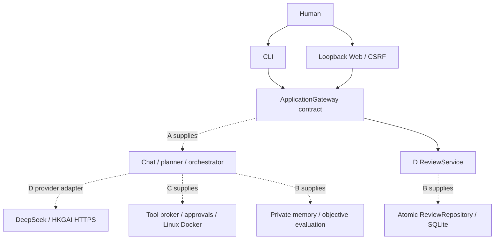

# Architecture

Implemented on this branch: D's installation, provider adapters, CLI, loopback
Web UI, and ReviewService. All other boxes below are integration dependencies,
not implemented components.

Provider adapters use only Python's standard library, bounded requests and retries,
no redirects, no raw provider exception output, and private external credentials.
Agent tool/network policies remain C's responsibility.

The Web server binds 127.0.0.1 only, requires exact Host on all requests, exact
Origin plus per-process CSRF token on writes, JSON object bodies under 64 KiB,
and refuses transfer encoding. The page uses textContent for untrusted output
and a nonce-based CSP. No CORS, external scripts, remote fonts or public hosting.
Use the printed 127.0.0.1 URL; localhost is deliberately not an alternate Host.

Production persistence belongs to B. The gateway must never return credentials;
known environment key values and secret-named fields are additionally redacted
at CLI/HTTP output. Demo state is volatile and explicitly has no execution.
