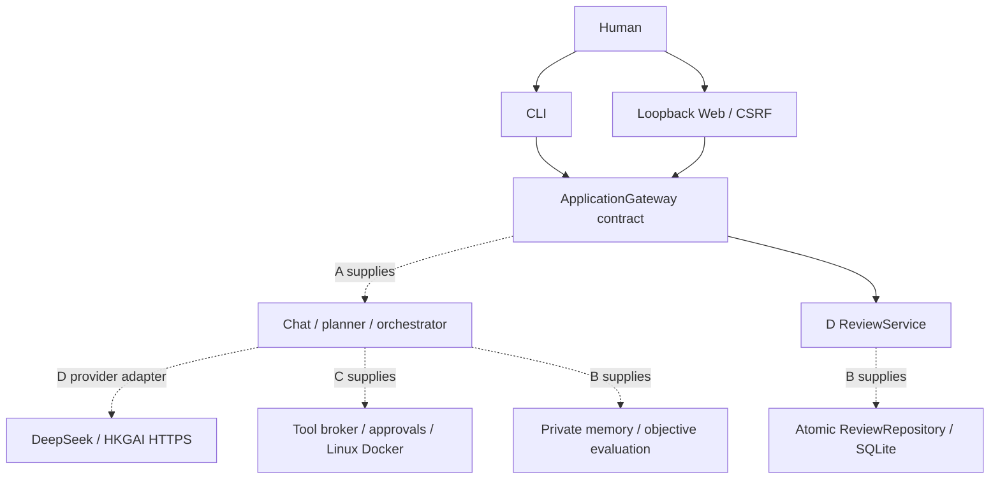

# Architecture

Implemented on this branch: D's installation, provider adapters, CLI, loopback
Web UI, and ReviewService. All other boxes below are integration dependencies,
not implemented components.



Provider adapters use only Python's standard library, bounded requests and retries,
no redirects, no raw provider exception output, and private external credentials.
Agent tool/network policies remain C's responsibility.

The Web server binds 127.0.0.1 only, requires exact Host on all requests, exact
Origin plus per-process CSRF token on writes, JSON object bodies under 64 KiB,
and refuses transfer encoding. The page uses textContent for untrusted output
and a nonce-based CSP. No CORS, external scripts, remote fonts or public hosting.
Use the printed 127.0.0.1 URL; localhost is deliberately not an alternate Host.

Production persistence belongs to B. The gateway must never return credentials;
known environment key values and secret-named fields are additionally redacted
at CLI/HTTP output. Demo state is volatile and explicitly has no execution.

## C05 durable SQLite storage

Runtime persistence is stored below the ignored `.evo/` directory:

```text
.evo/
├── events.sqlite3
└── agents/
    └── <validated-agent-id>/
        └── memory.sqlite3
```
`events.sqlite3` stores tasks, messages, append-only trace events, tool action metadata, approval or clarification requests, and human review state. Every SQLite operation opens and explicitly closes its connection. The adapter enables foreign keys and a bounded busy timeout for every connection.

Schema changes are versioned under evo.adapters.persistence.migrations. A new empty state directory is migrated automatically. A database with a schema newer than the running application is rejected rather than silently modified.

Human review is separate from technical execution status. Review decisions use an expected-state conditional update in one write transaction. The review update and its audit event commit or roll back together. Revision task creation, parent linking, review-state transition and trace events also share one transaction.

Each agent receives a physically separate memory database. C05 establishes its location, validation and initial schema only. Recall, ranking, bid adjustment and the no-memory ablation are implemented by C12.

SQLite databases are trusted application state. They must never be mounted into an agent Docker sandbox, included in task artifacts, committed to Git, or exposed through Web responses. Event payloads contain bounded non-secret metadata rather than credentials or raw environment variables. 
