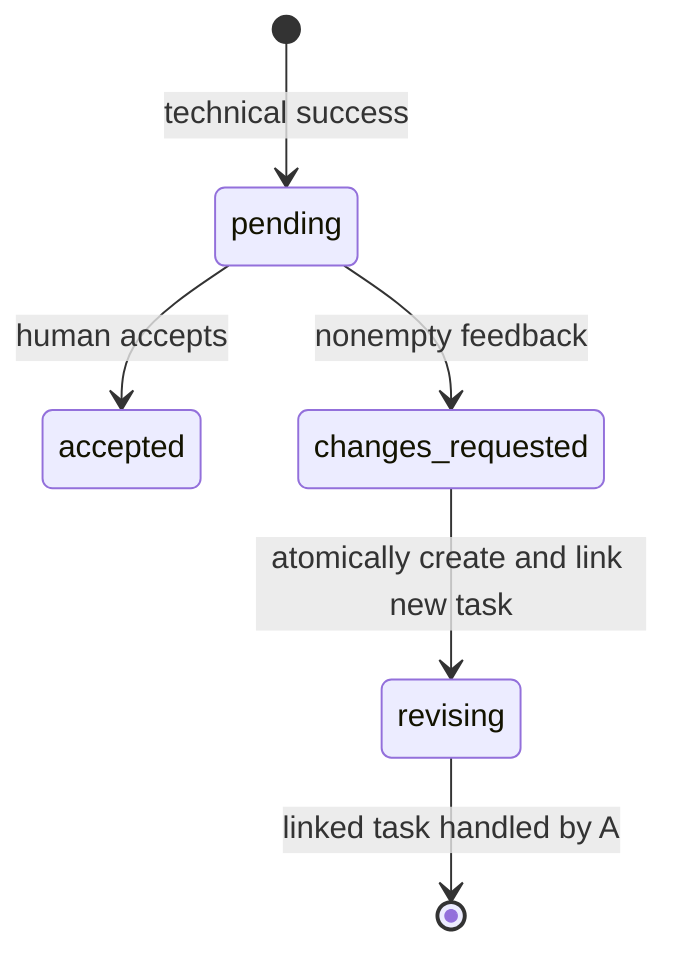

# Workflow and API

CLI commands: run, dm, group, eval, metrics, trace, memory, review, revision,
answer, setup-key (alias setup-hkgai-key), web. See python -m evo COMMAND --help.
Global --state and --demo flags precede the command.

## Task execution (A/C integration)
A owns created/planning/running/waiting_human/success/failed/blocked state. C
provides request IDs and approval actions. Pending approval/clarification records
appear in the inbox; answer dispatches only the human's explicit answer.
The backend validates current request state and resumes the proper task. A denied
or unanswered approval must never be converted to approval by the interface.

## Human review (D + B)

ReviewService validates successful execution and pending review. Repository methods
must atomically recheck state to reject duplicate/conflicting requests. A revision
creates a new task, preserves the original technical success, and links parent and
child. Review state and objective assessment results remain separate.

GET / serves the UI; GET /api/state returns snapshot. POST /api/{operation}
dispatches the operation table in INTEGRATION.md. Responses: 200 dispatched,
400 malformed JSON, 403 Host/Origin/token mismatch, 404 route missing,
409 invalid request/state conflict, 413 body limit, 415 content type,
500 backend failure without exception contents. A 200 result may still contain
status=blocked/failed: consumers must inspect the task result.

## Restart behavior
A server restart invalidates the CSRF token; refresh the page. Demo loses all
state. Real backend restart must recover persisted trace/review records, reject
stale decisions, and reconcile in-flight jobs and approval requests. That requires
B/C's durable store and is pending; this branch provides only the repository
contract and service-recreation test with a shared in-memory fixture.

## C05 persistence and restart recovery

Tasks, task-linked messages, trace events, action metadata, approval requests and
human reviews are durable in `events.sqlite3`. Reconstructing the application
with the same state path recovers these records.

A successful task receives an independent pending human review record. Accepting
or requesting changes does not rewrite the task's technical `success` status.
When changes are requested, revision creation atomically:

1. verifies the expected review state;
2. creates one child task;
3. links the child from the review;
4. changes the review state to `revising`;
5. appends the audit events.

Duplicate or stale review operations return a state conflict and do not append
dirty events or create duplicate children.

C05 does not yet resume an executing process or an in-memory model/tool loop.
Later orchestration and approval commits must reconcile persisted pending records
when the process starts.
